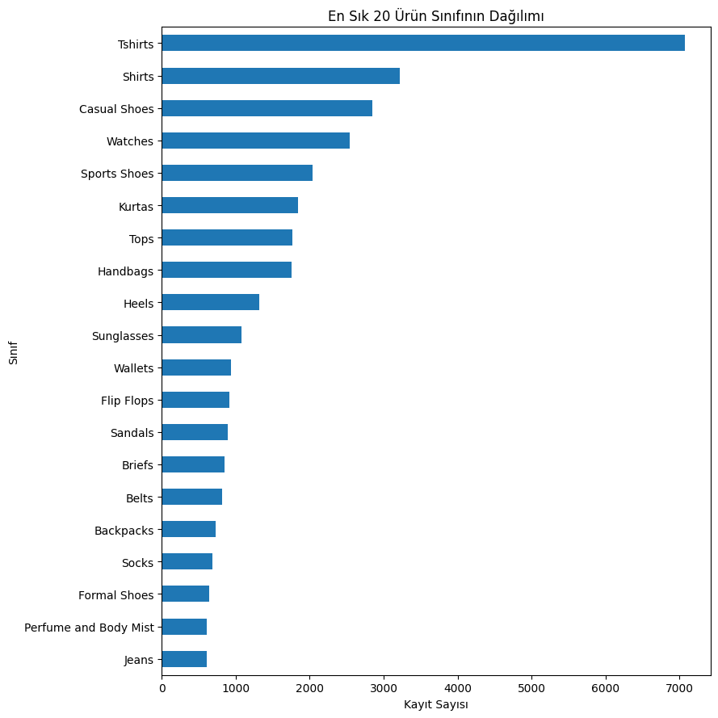
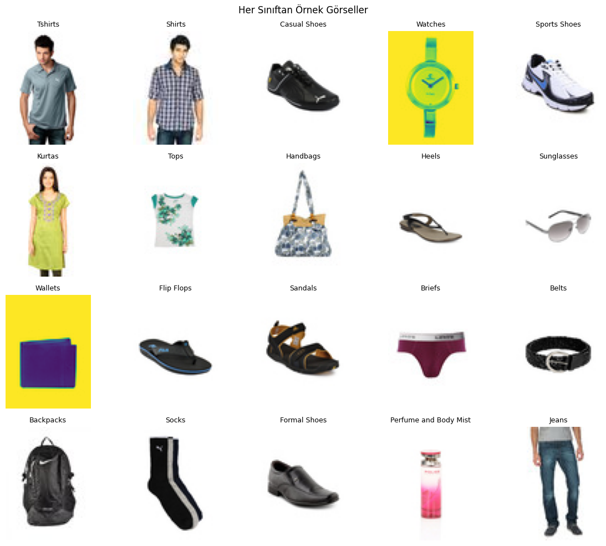
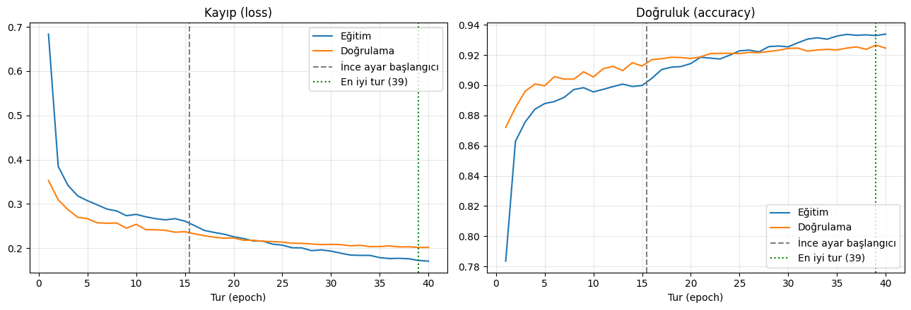
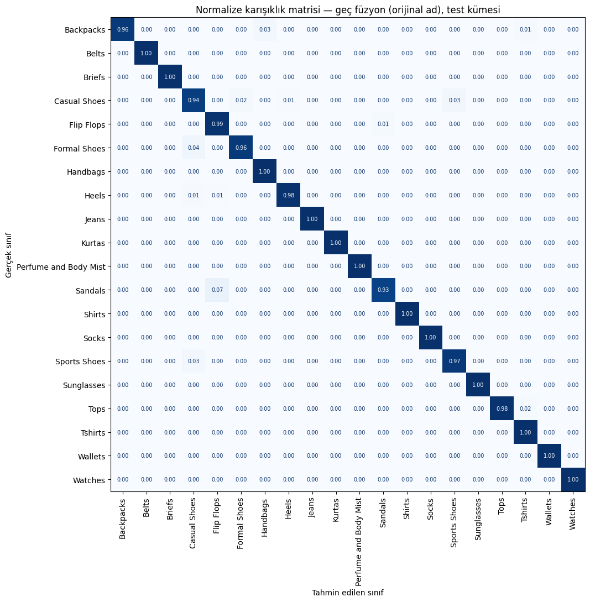
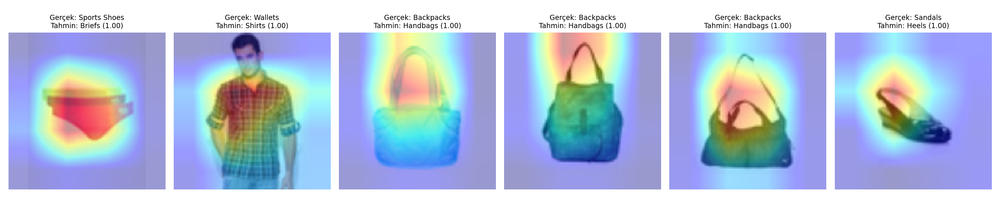
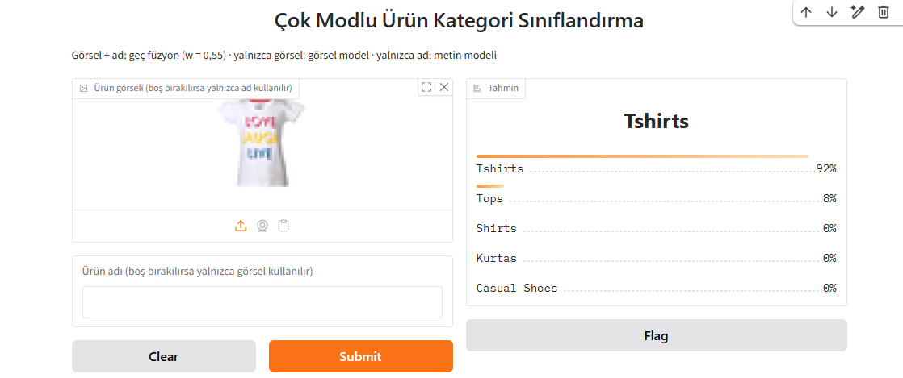
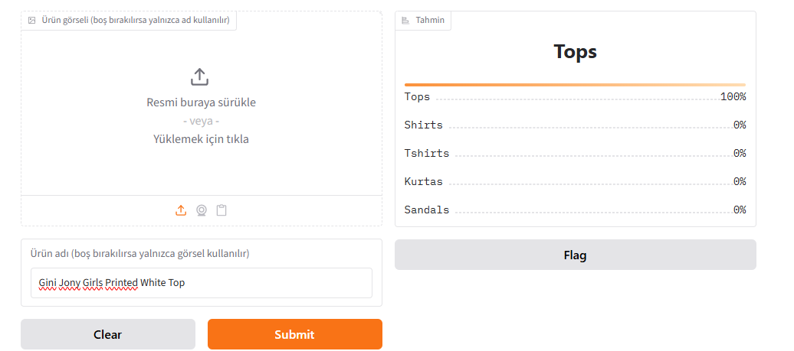
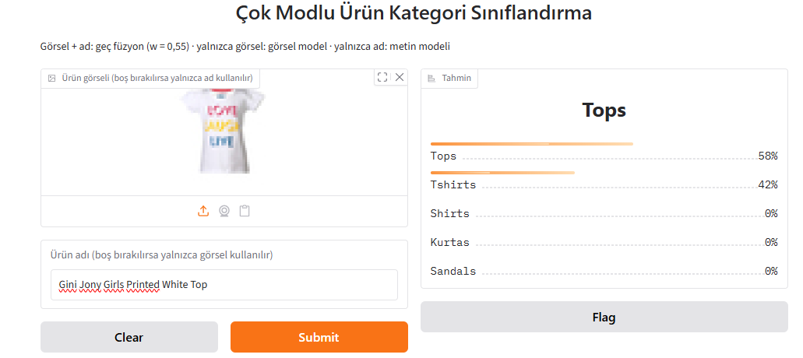

# Çok Modlu Ürün Kategori Sınıflandırma

E-ticaret sitelerinde binlerce ürün satıcılar tarafından yükleniyor ve her ürünün doğru kategoriye girmesi gerekiyor. Bu projede bunu otomatik yapmaya çalıştım: Bir ürünün kategorisini yalnızca **adına** ve **fotoğrafına** bakarak tahmin eden modeller kurdum.

Önce ürün adı için bir metin modeli, ürün fotoğrafı için bir görsel model eğittim. Sonra ikisini iki farklı yöntemle birleştirip hangisinin daha iyi çalıştığını karşılaştırdım. Satıcıların yazdığı ürün adları her zaman açık olmadığı için asıl cevabını aradığım soru şuydu: **Ürün adı yetersiz kaldığında fotoğraf bu açığı ne kadar kapatabiliyor?**

| | |
|---|---|
| **Veri seti** | [Fashion Product Images (Small)](https://www.kaggle.com/datasets/paramaggarwal/fashion-product-images-small) |
| **Girdiler** | Yalnızca `productDisplayName` ve `images/<id>.jpg` |
| **Hedef** | `articleType`, en sık 20 sınıf (33.142 ürün) |
| **Birincil ölçüt** | Makro-F1 (ek olarak doğruluk ve sınıf bazlı F1) |
| **Ortam** | Google Colab, scikit-learn, TensorFlow/Keras |

## Depo içeriği

| Dosya | İçerik |
|---|---|
| `notebooks/01_veri_ve_metin.ipynb` | Veri hazırlama, keşifsel analiz, bölme, metin modeli, maskeleme |
| `notebooks/02_gorsel_model.ipynb` | Görsel model (Keras, EfficientNetB0) |
| `notebooks/03_fuzyon.ipynb` | Geç ve ara füzyon, hata analizi |
| `notebooks/04_ek_gorevler.ipynb` | Ek görevler: Grad-CAM ve Gradio demosu |
| `split.csv` | Eğitim / doğrulama / test bölmesi |
| `requirements.txt` | Kütüphane sürümleri |
| `WORKLOG.md` | Gün gün çalışma günlüğü |
| `rapor/rapor.pdf` | Teknik rapor |
| `gorseller/` | Bu sayfadaki grafikler ve ekran görüntüleri |

## Nasıl çalıştırılır?

Notebook'lar Google Colab için hazırlandı ve birbirlerinin çıktılarını Drive'daki `MyDrive/onproje` klasörü üzerinden kullanıyor. Bu yüzden **01 → 02 → 03 → 04** sırasıyla çalıştırılmalı. 02 numaralı notebook GPU gerektiriyor (Çalışma zamanı → T4 GPU), diğerleri CPU'da çalışıyor.

---

## Çalışmanın akışı

### 1. Veriyi okuma ve temizlik

`styles.csv` dosyasında 44.446 ürün var. 22 satırda ürün adı tırnaksız bir virgül içerdiği için `pd.read_csv` hata veriyordu. Bu satırları silmek yerine `csv.reader` ile okuyup **onardım**. Sonra adı geçersiz olan 9 ürünü ("NA", "RTV_LoadTest" gibi) ve görseli olmayan 5 ürünü çıkardım, en sık 20 sınıfı seçtim. Geriye **33.142 ürün** kaldı.

`subCategory`, `gender` gibi sütunları hiç kullanmadım, çünkü cevabı doğrudan veriyorlar. Örneğin `subCategory` değeri "Watches" olan ürünlerin hepsi Watches sınıfında.

### 2. Veriyi tanıma

<p align="center">
  
  
</p>

Veri dengesiz: En büyük sınıf (Tshirts) en küçüğünden (Jeans) yaklaşık **11,6 kat** büyük. Bu yüzden her sınıfı eşit sayan makro-F1 ölçütünü kullandım. Görseller yalnızca **60×80 piksel** ve bazı sınıflar (Flip Flops ile Sandals gibi) birbirine çok benziyor.

### 3. Veriyi bölme

Veriyi tabakalı ve sabit tohumla **%70 / %15 / %15** oranında böldüm (23.199 / 4.971 / 4.972) ve `split.csv` olarak kaydettim. Bütün modeller bu bölmeyi kullanıyor. Bütün ayarları doğrulama kümesinde seçtim, test kümesini her model için yalnızca bir kez kullandım.

### 4. Metin modeli

Ürün adlarını **TF-IDF** ile sayılara çevirip **lojistik regresyon** ve **doğrusal SVM** ile sınıflandırdım. Varsayılan TF-IDF "T-shirt" kelimesindeki "t" harfini attığı için Tshirts ile Shirts karışıyordu. Ürün adlarını 2–5 karakterlik parçalara bölen **karakter TF-IDF**'e geçince bu sorun çözüldü. En iyi model: karakter TF-IDF + lojistik regresyon (C = 10).

**Maskeleme deneyi:** Gerçek hayatta ürün adları her zaman sınıfı söylemiyor. Bunu taklit etmek için sınıf adlarını ürün adlarından sildim:

```
"Turtle Check Men Navy Blue Shirt"  →  "Turtle Check Men Navy Blue"
```

Bu durumda metin modelinin başarısı belirgin şekilde düştü.

### 5. Görsel model

Keras'ta ImageNet'te önceden eğitilmiş **EfficientNetB0** ile transfer öğrenme yaptım. Görseller küçük olduğu için giriş boyutunu 128×128 seçtim. Önce gövde donukken yalnızca sınıflandırıcıyı eğittim, sonra son 30 katmanı açıp ince ayar yaptım. Veri artırma, EarlyStopping ve ModelCheckpoint kullandım.

<p align="center">
  
</p>

### 6. Füzyon

- **Geç füzyon:** İki model ayrı ayrı tahmin yapıyor, olasılıkları `w × metin + (1 − w) × görsel` ile birleştiriliyor. w'yi doğrulama kümesinde seçtim.
- **Ara füzyon:** Metni TruncatedSVD ile 256 sayıya sıkıştırıp görsel modelin 1.280 sayılık gömmesiyle birleştirdim ve küçük bir Keras MLP eğittim.

### 7. Hata analizi

<p align="center">
  
</p>

En iyi model 4.972 test ürününde 64 hata yaptı. Hataların **%69'u** ayakkabı ve terlik sınıfları arasında (en sık: Casual Shoes → Sports Shoes). Hataların çoğunda ürün adı türü söylemiyor (ör. "Red Tape Men Brown Shoes"), bir kısmında da etiketin kendisi yanlış görünüyor.

### 8. Ek görevler

**Grad-CAM:** Görsel modelin karar verirken görselin neresine baktığını ısı haritalarıyla gösterdim. Doğru tahminlerde model ürünün ayırt edici parçasına bakıyor (saatte kadran, gözlükte camlar). Yanlış tahminlerde ise saplı sırt çantalarının, model sapa baktığı için Handbags sanıldığını gördüm.

<p align="center">
  
</p>

**Gradio demosu:** Görsel yükleyip ürün adı yazınca sınıf olasılıklarını gösteren bir demo hazırladım. Demo yalnızca görselle, yalnızca adla ya da ikisi birlikte (geç füzyon) çalışabiliyor.

<p align="center">
  
  
</p>
<p align="center">
  
</p>

Aynı denemenin üç hali: Yalnızca görsel verilince görsel model **Tshirts %92** diyor. Yalnızca "…White Top" adı verilince metin modeli **Tops %100** diyor. İkisi birlikte verilince geç füzyon iki tahmini tartıyor ve sonuç **Tops %58, Tshirts %42** çıkıyor:

```
Tops:    0,55 × 1,00 + 0,45 × 0,08 ≈ 0,58
Tshirts: 0,55 × 0,00 + 0,45 × 0,92 ≈ 0,42
```

---

## Sonuçlar

| No | Model | Ürün adı | Doğruluk | Makro-F1 |
|---|---|---|---:|---:|
| 1 | TF-IDF + lojistik regresyon | Orijinal | 0,9843 | 0,9821 |
| 2 | TF-IDF + doğrusal SVM | Orijinal | 0,9849 | 0,9835 |
| 3 | En iyi metin modeli (LR) | Maskelenmiş | 0,8407 | 0,8172 |
| 4 | Keras transfer öğrenme (yalnızca görsel) | Kullanılmıyor | 0,9204 | 0,9251 |
| 5 | Geç füzyon (w = 0,55) | Orijinal | 0,9871 | **0,9850** |
| 6 | Geç füzyon (w = 0,50) | Maskelenmiş | 0,9491 | **0,9535** |
| 7 | Ara füzyon | Orijinal | 0,9773 | 0,9755 |
| 8 | Ara füzyon | Maskelenmiş | 0,9395 | 0,9445 |

*Tablo 1: Test kümesi sonuçları.*

- **Ürün adı açıkken** metin modeli zaten çok iyi. Görsel eklemek yalnızca **+0,3 puan** kazandırıyor.
- **Ürün adı zayıfken** (maskeli) metin modeli 0,82'ye düşüyor. Görsel eklenince sonuç 0,95'e çıkıyor, yani görselin katkısı **+13,6 puan**. Projenin ana sorusunun cevabı bu: Ad yetersiz kaldığında fotoğraf açığın büyük kısmını kapatıyor.
- En iyi yöntem **geç füzyon**. Ara füzyon her iki durumda yaklaşık 1 puan geride kaldı.

---

## Yapay zekâ kullanımı

Çalışma sırasında Claude'u kod yazma yardımı almak ve hata ayıklamak için kullandım. Ayrıntılar `WORKLOG.md` dosyasının "Yapay zekâ kullanımı" bölümünde.

---

Nurgül Sarıtaş · Bursa Teknik Üniversitesi, Bilgisayar Mühendisliği
